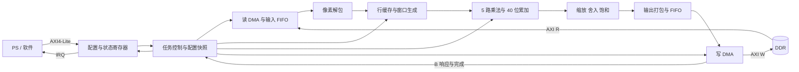

# SystemVerilog AXI 卷积加速器实现计划

版本：v0.1，待审查
日期：2026-10-14
交付目标：可综合的 SystemVerilog RTL、自动化仿真、软件使用示例及 Zynq-7020 集成脚本。

本文是实现方案，尚未实现 RTL。标注为“建议”的行为是为形成完整方案而选定的默认值，可在审查时调整。

## 1. 工程现状与设计目标

- 当前 `src/` 下没有已有 RTL 或接口规范。
- 上一级 `accl_hw.xpr` 的器件为 `xc7z020clg400-2`。
- 已有 `design_hw.bd` 为空，记录的 Vivado 版本为 2025.2，尚未配置 PS 和 AXI 互连。
- 当前环境有 Verilator 5.052；未在 PATH 中发现 Vivado。因此功能仿真可以在当前环境执行，综合与实现验收需要 Vivado 环境。

实现一个卷积模块，通过一个 AXI 从接口接收配置，通过一个 AXI 主接口从内存读取输入并将输出写回内存。必须支持运行时选择 3×3 / 5×5 卷积核、8 / 16 位定点元素。

建议首版采用以下明确边界：

| 项目      | 首版方案                                                 |
| --------- | -------------------------------------------------------- |
| 控制接口  | AXI4-Lite Slave，32 位地址、32 位数据                    |
| 数据接口  | AXI4 Master，32 位地址、64 位数据，支持读写              |
| 输入/权重 | 有符号二进制补码，8 位或 16 位，同一次任务使用相同位宽   |
| 输出      | 与输入相同位宽，定点缩放后饱和                           |
| 核尺寸    | 3×3 或 5×5，运行时选择                                 |
| 卷积模式  | 单通道输入、单通道输出，二维 VALID，stride=1、dilation=1 |
| 权重装载  | 通过 AXI4-Lite 写入最多 25 个权重寄存器                  |
| 图像装载  | 主 AXI 从 DDR 读取，每个输入元素仅读取一次               |
| 偏置      | 一个有符号 32 位偏置，量纲与乘积一致                     |
| 并行度    | 5 路乘法器，一个窗口按核的行数分时计算                   |
| 时钟      | 所有 RTL 使用同一个时钟，目标频率 100 MHz                |
| 图像范围  | 建议最大宽 2048、最大高 8192，可综合参数配置             |
| 任务调度  | 单任务，完成后由软件启动下一次任务；提供 IRQ             |

首版不包含多通道累加、批处理、SAME padding、可变步长、混合位宽、池化或激活函数。若需要多个输出通道，软件可重复提交不同权重的任务，但输入会重复读取。

## 2. 精确计算定义

### 2.1 输入布局与输出尺寸

输入、输出均采用行优先布局。元素连续存放，16 位元素采用小端字节序。源和目标分别配置行跨度，单位为字节。

设输入宽高为 `W、H`，核尺寸为 `K`：

```text
OW = W - K + 1
OH = H - K + 1

src_element(y, x) = SRC_ADDR + y * SRC_STRIDE + x * ELEMENT_BYTES
dst_element(y, x) = DST_ADDR + y * DST_STRIDE + x * ELEMENT_BYTES
```

要求 `W >= K` 且 `H >= K`。输出不会包含边界补零产生的元素。

### 2.2 核方向

建议采用 CNN 常用的互相关语义，权重不翻转：

```text
A(y, x) = BIAS + Σ[i=0..K-1] Σ[j=0..K-1]
                    signed(X(y+i, x+j)) * signed(W(i, j))
```

3×3 使用 `WEIGHT[0..8]`；5×5 使用 `WEIGHT[0..24]`，均按核自身的行优先顺序排列。若应用要求数学卷积，软件在装载前将权重旋转 180°。

### 2.3 定点缩放、舍入与饱和

建议硬件以整数计算，并使用 `OUT_SHIFT` 指定输出缩放，不在数据流中携带小数位信息。

输入、权重和输出的小数位分别为 `Fx、Fw、Fy` 时：

```text
OUT_SHIFT = Fx + Fw - Fy
```

首版支持 `OUT_SHIFT=0..31`，不支持负数左移。`BIAS` 应由软件量化到 `Fx+Fw` 个小数位。复位后的偏置为 0。

- 8 位和 16 位输入先符号扩展，再乘法。
- 乘积统一按有符号 32 位处理；累加器使用有符号 40 位。
- 25 项 16×16 位乘积与一个 32 位偏置的总和不会溢出 40 位累加器。
- 首版建议默认启用“就近舍入，中点远离零”，正负数对称。

```text
当 s = OUT_SHIFT = 0：Q = A
当 s > 0 且 ROUND_EN = 1：
    Q = sign(A) * ((abs(A) + 2^(s-1)) >> s)
当 s > 0 且 ROUND_EN = 0：
    Q = A >>> s     // 算术右移，负数向负无穷取整

Y = clamp(Q, -128, 127)           // 8 位模式
Y = clamp(Q, -32768, 32767)       // 16 位模式
```

计算绝对值与舍入加数时使用至少 41 位中间值。先舍入、再饱和，不允许直接丢弃高位而产生回绕。RTL 显式声明乘法、加法和移位的符号性与位宽，避免 SystemVerilog 表达式隐式转换。

## 3. 顶层结构与模块划分



| 文件                       | 职责                                             |
| -------------------------- | ------------------------------------------------ |
| `rtl/conv_accel_pkg.sv`  | 寄存器地址、状态、错误码与公共类型               |
| `rtl/conv_accel_top.sv`  | 顶层 AXI 端口、IRQ、模块连接                     |
| `rtl/axi_lite_regs.sv`   | AXI4-Lite 协议、寄存器读写、命令与 W1C 状态      |
| `rtl/conv_controller.sv` | 参数校验、任务快照、任务状态机、完成与错误管理   |
| `rtl/axi_read_dma.sv`    | 逐行读取、突发拆分、读响应处理                   |
| `rtl/pixel_unpack.sv`    | 64 位 AXI 数据转换为 8/16 位像素流，跳过行尾填充 |
| `rtl/conv_window.sv`     | BRAM 行缓存、横向移位寄存器、窗口坐标和有效标记  |
| `rtl/conv_mac.sv`        | 5 路乘法、流水化加法树、窗口累加与偏置           |
| `rtl/conv_quantize.sv`   | 定点缩放、舍入和饱和                             |
| `rtl/pixel_pack.sv`      | 像素打包、行尾部分字节的 WSTRB 与元数据          |
| `rtl/axi_write_dma.sv`   | 写突发、AW/W 独立握手、B 响应、最终写完成        |
| `rtl/rv_fifo.sv`         | 参数化 ready/valid FIFO，可推导 BRAM             |

模块内部统一使用 `valid/ready`。数据及其坐标、行尾、帧尾标记必须一起保持和传递。所有状态只在相应握手或明确的流水线推进事件发生时更新。

## 4. AXI 接口设计

### 4.1 AXI4-Lite 从接口

- 配置地址是外部映射基址内的字节偏移，寄存器窗口至少 4 KiB。
- AW 与 W 独立锁存，允许任意先后到达；只有地址和数据都收到后才执行写入。
- 同时最多接受一个待处理写事务和一个待处理读事务。
- `BVALID`、`RVALID` 在握手前保持；`BRESP`、`RDATA`、`RRESP` 同样保持。
- 普通寄存器按 `WSTRB` 进行字节更新；命令和 W1C 操作只对被选中的字节生效。
- 未实现、未对齐的地址，以及对只读寄存器的写入，返回 `SLVERR`。
- BUSY 时读取允许；配置和权重写入返回 `SLVERR`。中断使能和 W1C 状态写入允许。
- 复位采用低有效复位输入，同步释放。

### 4.2 AXI4 主接口

建议参数：`ADDR_WIDTH=32`、`DATA_WIDTH=64`、`ID_WIDTH=1`、`MAX_BURST_BEATS=16`，ID 固定为 0。顶层分别提供五个标准 AXI 通道；读写属于同一个主接口。

- 仅发起 INCR 突发；`ARSIZE=AWSIZE=3`，每 beat 8 字节。
- 每个方向最多一个未完成突发，读写方向可并行。
- `AxLEN=beats-1`；任何突发不跨行、不跨 4 KiB 边界，最多 16 beats。
- 发起读突发前，为该突发全部 R beats 预留输入 FIFO 空间，避免接收溢出。
- 发起写突发前，将该突发全部数据及 strobes 保留在输出 FIFO 中；AW、W 通道独立驱动，不等待对方 READY 才拉高 VALID。
- `WLAST` 精确对应突发最后一个 beat；等待 B 响应后才提交下一写突发。
- 检查每个 `RRESP` 和 `BRESP`；验证 `RLAST` 与预期长度一致。
- 地址、数据与控制在 `VALID && !READY` 时保持稳定。
- 建议 `AxLOCK=0`、`AxPROT=0`、`AxCACHE=0`、`AxQOS=0`，采用普通非缓存访问；PS 侧仍需软件缓存维护。

突发 beat 数由以下最小值决定：

```text
min(16, 当前行剩余 beats, 到下一个 4 KiB 边界的 beats)
```

### 4.3 对齐、行跨度与行尾

为了简化首版 DMA，源地址、目标地址和两者行跨度都要求 8 字节对齐。

```text
SRC_STRIDE >= align_up(W  * ELEMENT_BYTES, 8)
DST_STRIDE >= align_up(OW * ELEMENT_BYTES, 8)
```

每行只读取 `align_up(W*ELEMENT_BYTES,8)` 字节，解包器忽略最后一个 beat 的填充字节，不读取跨度内剩余的间隙。软件必须分配这些可读填充字节。

每行输出打包独立开始和结束。末尾 beat 只对有效输出字节置 `WSTRB=1`，填充字节及跨行间隙保持原值。最后一个部分 beat 不与下一行像素拼接。

启动前使用至少 64 位运算检查两块缓冲区的末端地址，防止 32 位地址回绕。源、目标范围不得重叠，首版不支持原地卷积；采用包含行间隙的外包区间做保守重叠检查。

## 5. 配置寄存器方案

所有寄存器为 32 位，4 字节对齐。只读值由硬件生成；普通可写寄存器未列出的位保留为 0。

| 偏移            | 名称           | 属性   | 定义                                                               |
| --------------- | -------------- | ------ | ------------------------------------------------------------------ |
| `0x000`       | ID             | RO     | 固定`0x434F4E56`，标识 CONV                                      |
| `0x004`       | VERSION        | RO     | 初版`0x00010000`                                                 |
| `0x008`       | CONTROL        | WO     | bit0=START；读返回 0                                               |
| `0x00C`       | STATUS         | RO/W1C | bit0=BUSY，只读；bit1=DONE、bit2=ERROR、bit3=CMD_REJECT，写 1 清除 |
| `0x010`       | IRQ_ENABLE     | RW     | bit0=完成中断使能，bit1=错误中断使能                               |
| `0x014`       | ERROR_CODE     | RO     | 最近一次任务/启动错误，清除 ERROR 时清零                           |
| `0x018`       | CONFIG         | RW     | bit0：0=3×3、1=5×5；bit1：0=8 位、1=16 位；bit2=ROUND_EN         |
| `0x01C`       | WIDTH          | RW     | 输入宽度，bits[15:0]                                               |
| `0x020`       | HEIGHT         | RW     | 输入高度，bits[15:0]                                               |
| `0x024`       | SRC_ADDR       | RW     | 输入首地址                                                         |
| `0x028`       | DST_ADDR       | RW     | 输出首地址                                                         |
| `0x02C`       | SRC_STRIDE     | RW     | 输入行跨度，字节                                                   |
| `0x030`       | DST_STRIDE     | RW     | 输出行跨度，字节                                                   |
| `0x034`       | OUT_SHIFT      | RW     | bits[4:0]，0..31                                                   |
| `0x038`       | BIAS           | RW     | signed int32，乘积定点尺度                                         |
| `0x03C`       | OUT_WIDTH      | RO     | 最近一次通过校验的任务的 OW                                        |
| `0x040`       | OUT_HEIGHT     | RO     | 最近一次通过校验的任务的 OH                                        |
| `0x044`       | CYCLE_COUNT_LO | RO     | 当前/最近任务周期计数低 32 位                                      |
| `0x048`       | CYCLE_COUNT_HI | RO     | 周期计数高 32 位                                                   |
| `0x04C`       | MAX_WIDTH      | RO     | 综合配置的最大输入宽度                                             |
| `0x050`       | MAX_HEIGHT     | RO     | 综合配置的最大输入高度                                             |
| `0x054`       | CAPABILITIES   | RO     | bits[0..4]：3×3、5×5、signed8、signed16、VALID 支持，初版均置 1  |
| `0x100 + 4*i` | WEIGHT[i]      | RW     | `i=0..24`；16 位模式取低 16 位，8 位模式取低 8 位，各自符号扩展  |

复位：状态、地址、尺寸、偏置、权重、中断使能和计数均为 0；`CONFIG=0x4`（3×3、8 位、启用舍入），`OUT_SHIFT=0`。

命令语义：

1. IDLE 状态接受 START，快照所有配置与权重，清除上次 DONE、ERROR、ERROR_CODE 和 CMD_REJECT，然后校验参数。
2. 参数无效时，不发起主 AXI 请求，设置 ERROR 与对应错误码，BUSY 保持 0。
3. 参数有效时设置 BUSY，开始任务，整个任务只使用快照值。
4. BUSY 时收到 START：AXI-Lite 写事务正常响应，忽略 START，置 CMD_REJECT，不中断当前任务。
5. 最后一个输出突发的 B 响应成功且所有模块完成收尾后，清 BUSY、置 DONE。
6. 运行期间发生错误：收尾后清 BUSY、置 ERROR，不置 DONE；输出缓冲区可能只完成部分写入，由软件作废。

`IRQ = (DONE && IRQ_ENABLE[0]) || (ERROR && IRQ_ENABLE[1])`，采用电平信号，软件通过 W1C 清除。并发硬件置位与软件清除时，以置位优先，避免丢事件。

周期计数从有效任务进入 BUSY 开始，到正常完成或错误收尾结束。计数在空闲后保持；运行中通过“高、低、高”重读方式获得一致的 64 位值。

## 6. 行缓存与窗口生成

### 6.1 存储组织

- 最大配置需要 `K-1=4` 行缓存，每行最多 2048 个 16 位元素，原始容量约 16 KiB。
- 8 位输入也符号扩展为 16 位缓存，减少两种格式下的存储控制差异。
- 3×3 使用两个行缓存 bank；5×5 使用四个 bank；当前输入行不占用额外整行缓存。
- 使用循环 bank 映射，读取历史行后才覆盖最旧 bank；逻辑行序映射到对应物理 bank。
- 每个 bank 使用简单双端口 BRAM，独立读、写端口；采用分周期读旧值再覆盖，避免依赖器件未定义的同地址碰撞行为。
- 横向窗口寄存器最大为 5×5，缓存每一逻辑行最近 K 个像素。

### 6.2 更新规则与背压

1. 接受一个像素后，发起历史行的同步 BRAM 读取，锁存像素与坐标。
2. 历史像素返回后，更新相应横向窗口，再写入当前像素覆盖最旧行缓存位置。
3. 当 `y >= K-1 && x >= K-1` 时生成窗口，其输出坐标为 `(y-K+1,x-K+1)`。
4. MAC 接受窗口后，在本次窗口计算完成前保持窗口不变；期间不推进输入像素。
5. 每个输入行开始时清除横向窗口及相应有效状态，防止上一行右侧数据流入下一行窗口。
6. 每次任务重置坐标和历史行有效状态。无需清空 BRAM 内容，通过有效状态屏蔽旧任务数据。

首版采用逐像素准备、逐窗口计算的调度方式，允许插入气泡周期，优先保证 BRAM 推导、窗口正确性和背压控制。窗口未准备完成时，不接受下一像素。

输出 FIFO 满时，量化结果及窗口计算状态保持，背压依次传递到 MAC、窗口生成、解包器和输入 FIFO。DMA 接收空间通过突发预留管理，不依赖下游继续运行才能容纳已发起的读事务。

## 7. MAC 与量化流水线

- 配置 5 路有符号乘法器，统一按 16×16 位实现，计划推导到 DSP48E1。
- 对每个窗口，第 `i` 次投递并行计算核第 `i` 行的乘积。
- 3×3 每行使用 3 路乘法，其余两路置零；5×5 每行使用 5 路。
- 对行内乘积进行流水化加法树求和，再累加到 40 位窗口累加器。
- 窗口开始时装载符号扩展后的 BIAS；通过行序号和最后一行标记管理流水线排空。
- 收到最后一行累加结果后才能量化；发出一个输出元素后再允许下一个窗口。
- 加法树分级寄存，流水线延迟作为明确常量/参数管理，不依赖仅等待 K 个时钟的假设。

性能估算采用：

```text
T_cycles ≈ WH * C_prepare + OW*OH * C_window + T_DMA_stall

C_prepare：BRAM 读取、窗口更新的周期数，首版预计约 2
C_window：K 次行投递 + 加法/累加流水线排空 + 量化/结果交付
```

大图稳态下预计每个输出约 10～14 个周期，100 MHz 时约 7～10 Mpixel/s，最终数值以实际流水线与仿真计数为准，不作为当前已实现的性能承诺。

输入、输出 DDR 有效数据量约为 `WH*E + OW*OH*E` 字节，另有输入行尾对齐填充；权重通过配置接口装载。使用行缓存使 DDR 读取量不随 K² 增长。

输入和输出 FIFO 各建议 64 个 64 位 beat（各 512 字节），输出 FIFO 同时保存 strobe、行尾和帧尾信息。尾部不足 16 beats 时，依靠行尾标记提交短突发，不等待 FIFO 填满。

## 8. 任务控制与异常处理

建议主状态：`IDLE → VALIDATE → RUN → FINALIZE → IDLE`；异常路径为 `VALIDATE → IDLE` 或 `RUN/FINALIZE → DRAIN_ERROR → IDLE`。

启动前检查：

- WIDTH/HEIGHT 不为 0、不超过参数上限，且均不小于 K。
- SRC/DST 地址、行跨度满足 8 字节对齐及最小跨度。
- 源/目标末端地址不越过 32 位地址空间，两个外包范围不重叠。
- CONFIG、尺寸、OUT_SHIFT 等寄存器保留位不得写入非法值：寄存器写入时按可写位掩码处理，配置值按最终有效字段解释。

建议错误码：

| 值    | 含义                  |
| ----- | --------------------- |
| `0` | 无错误                |
| `1` | 图像尺寸不合法        |
| `2` | 地址或行跨度未对齐    |
| `3` | 行跨度不足            |
| `4` | 地址范围溢出          |
| `5` | 输入输出范围重叠      |
| `6` | AXI 读响应错误        |
| `7` | AXI 写响应错误        |
| `8` | AXI 读长度/RLAST 异常 |

发生运行错误后保留首次错误码，停止提交新的读写突发。已经拉高 VALID 的请求必须维持到握手；已提交读请求继续接收/丢弃其数据，已承诺写请求完成剩余 W beats 并接收 B。清除未提交的数据及计算结果，确认事务收尾后才清 BUSY。

对于长度异常但从设备仍可结束的读响应，按协议错误路径排空至事务结束；对永不返回响应、永不出现必要 RLAST 等无法结束的总线故障，不能承诺内部恢复。首版不提供会取消 AXI 事务的软件 ABORT/软复位。软件等待设置超时；必要时对模块和相关互连协调复位。上电/外部复位期间不要求保存正在执行的任务。

DONE 表示所有输出写响应均成功，不仅表示最后一个乘加结果已经产生。

## 9. Zynq-7020 集成与软件流程

### 9.1 Vivado 连接

- 建议 PS `M_AXI_GP0` 经 AXI 互连连接模块 `S_AXI_CTRL`。
- 模块 `M_AXI_DATA` 经支持 AXI4 到 AXI3 转换的互连/协议转换器，连接 PS 的 64 位 `S_AXI_HP0` 访问 DDR。
- Zynq-7000 HP 接口为 AXI3；即使突发限制到 16 beats，仍需明确处理协议差异，不能直接假定 AXI4 与 AXI3 全部信号兼容。
- 使用 PS FCLK 提供目标 100 MHz 时钟；控制和数据通路同频，复位经 `proc_sys_reset` 同步释放。
- IRQ 接入 PS PL 中断输入。控制基址建议 `0x43C0_0000`，实际地址由 Address Editor 分配。
- 新建 Tcl 集成脚本供复现和审查；执行前保留原工程，确认方案后再接入现有 BD。

### 9.2 软件执行顺序

1. 分配满足地址可达性、对齐和跨度约束的源、目标 DDR 缓冲区。
2. 填充输入、清理输入缓存；目标缓冲区在交给 DMA 前完成必要缓存维护。
3. 等待 BUSY=0，写入尺寸、地址、跨度、核模式、位宽、OUT_SHIFT、BIAS 和权重。
4. 通过内存屏障确认配置及缓存维护完成，写 START。
5. 轮询 DONE/ERROR 或等待 IRQ，同时设置软件超时。
6. 成功后按平台规范失效目标缓存，再读取输出；错误时不使用本次输出。
7. W1C 清除状态，复用模块提交下一任务。

Zynq HP 通路不提供 CPU 缓存一致性。裸机示例使用 BSP 缓存 API；Linux 示例应使用 DMA API 分配/映射缓冲区，不能简单把用户空间虚拟地址写入 SRC_ADDR/DST_ADDR。

## 10. 验证计划与验收条件

### 10.1 位精确参考模型

使用 Python 实现宽整数参考模型，逐项复现：核方向、符号扩展、偏置尺度、舍入、饱和、行跨度及输出布局。保存随机种子、输入、权重、配置和期望输出，失败时可重放。

### 10.2 自动化仿真

优先使用 Verilator + Python/cocotb，搭建 AXI-Lite 主 BFM 和可随机等待的 AXI 内存从 BFM；依赖版本在验证阶段固定。AXI 内存模型支持响应错误注入及写 strobe 检查。

| 类别       | 必测场景                                                              |
| ---------- | --------------------------------------------------------------------- |
| 模式覆盖   | 3×3×8、3×3×16、5×5×8、5×5×16 四种组合                         |
| 基础计算   | 零输入、零核、单位核、全 1 核、非对称核、正负混合、非零偏置           |
| 极值       | -128/127、-32768/32767、最大正负累加、输出正负饱和                    |
| 定点行为   | shift=0/1/31，舍入开关，正负中点，负数算术右移                        |
| 尺寸与窗口 | 输入恰好 K×K、输出单行/单列、矩形图、小宽度、最大宽度、跨任务残留    |
| 内存布局   | 8/16 位两种小端布局、行尾不足 8 字节、不同源/目标跨度、填充与间隙哨兵 |
| AXI 突发   | 1/16 beats、跨 4 KiB 拆分、行尾短突发、地址/数据不同步                |
| AXI 背压   | AR/AW/W/B/R 与 AXI-Lite 各通道随机延迟、长暂停、输出 FIFO 满          |
| 控制       | WSTRB 字节写、AW/W 任意先后、BUSY 重启拒绝、BUSY 配置写拒绝、IRQ/W1C  |
| 错误       | 尺寸、对齐、跨度、地址回绕、重叠、RRESP/BRESP、可收尾 RLAST 异常      |
| 重复运行   | 位宽/核尺寸切换、连续至少 100 次任务、错误后恢复                      |

加入协议和内部不变量断言：

- VALID 等待 READY 时负载稳定；不得多收、多发或丢失 beat。
- 突发长度、4 KiB 边界、WSTRB、WLAST/RLAST 符合定义。
- FIFO 不溢出、不下溢；读请求预留量正确。
- 输入被处理 WH 次、有效输出恰好 OW×OH 次。
- 窗口在 MAC 占用时保持；行缓存读写及坐标在停顿中不漂移。
- 正常 DONE 发生时无未完成 AXI 请求、无待写输出。

### 10.3 可审查的验收门槛

1. 四种模式在定向测试和固定种子的随机测试中逐元素与参考模型完全一致；建议每模式至少 100 个随机任务。
2. 随机背压与错误收尾测试通过，无断言失败；目的范围之外的内存哨兵保持不变。
3. Verilator lint 无未处理的位宽、锁存器、多驱动警告；特殊警告须局部说明。
4. Vivado 综合能识别行缓存为 BRAM、乘法为 DSP，无意外大规模触发器行缓存。
5. 目标器件布局布线后满足 100 MHz，WNS≥0；所有接口有时钟约束，无未解释的时序违规。
6. 提交资源与性能报告，包含 LUT/FF/BRAM/DSP、四模式的周期数与 DDR 停顿占比。
7. PS 联调中完成至少一幅实际图像的 DDR 读写和软件参考比对。

建议模块资源预算：DSP≤16、BRAM36≤12、LUT≤12000。基础乘法器预计 5 个 DSP；行缓存预计 4 个 BRAM36，FIFO、推导方式和额外寄存器会增加资源。预算与映射估算均需综合证实。

## 11. 分阶段实施与交付

| 阶段           | 工作                                                 | 交付与完成条件                                   |
| -------------- | ---------------------------------------------------- | ------------------------------------------------ |
| P0：规格冻结   | 审查本文默认范围、核方向、数值规则、寄存器与性能目标 | 更新本计划，形成固定接口规范                     |
| P1：验证基础   | 公共包、参考模型、AXI BFM、仿真入口                  | 参考向量可重放，BFM 可独立产生背压/错误          |
| P2：控制与 DMA | AXI-Lite、参数校验、读写 DMA、FIFO                   | 地址规划、随机背压、部分字节写和错误收尾测试通过 |
| P3：计算通路   | 行缓存、窗口、MAC、量化                              | 四模式逐元素比对，窗口边界和定点极值正确         |
| P4：整机仿真   | 串接模块、IRQ、反复任务、异常路径                    | 全部功能及协议验收通过                           |
| P5：综合与时序 | BRAM/DSP 推导、100 MHz 优化、报告                    | 资源预算与时序验收通过；调整需更新规格           |
| P6：PS 联调    | IP 封装、BD Tcl、软件示例与缓存维护                  | DDR 实测结果一致、提交操作说明与性能记录         |

建议最终目录：

```text
src/
├── docs/
│   ├── conv_accel_implementation_plan.md
│   ├── register_map.md
│   └── verification_report.md
├── rtl/                    # 第 3 节列出的 RTL 模块
├── sim/
│   ├── reference_model.py
│   ├── test_conv_accel.py
│   ├── test_axi_dma.py
│   ├── requirements.txt
│   └── Makefile
├── scripts/
│   ├── lint.sh
│   ├── synth.tcl
│   ├── package_ip.tcl
│   └── create_bd.tcl
└── sw/
    ├── conv_accel_regs.h
    └── baremetal_example.c
```

## 12. 审查时需要确认的设计选择

以下均已给出默认方案，审查可以直接批准或修改相应条目：

1. **数据语义**：有符号 8/16 位，输入和权重同位宽，输出同位宽；通过 OUT_SHIFT 定义定点尺度。
2. **卷积范围**：单输入/输出通道、VALID、stride=1，核按互相关方向计算。
3. **接口**：AXI4-Lite 配置、64 位 AXI4 数据主接口、32 位 DDR 地址，单时钟 100 MHz。
4. **权重来源**：通过 AXI-Lite 的 25 个寄存器装载；不另设权重 DDR 读取模式。
5. **内存约束**：8 字节地址/跨度对齐，允许行尾填充，源目标不重叠。
6. **规模与性能**：默认最大 2048×8192；采用 5 路乘法器分时计算。如果实际要求每周期输出一个像素，应重新评估 25 路乘法和窗口/输出流水线。
7. **量化行为**：默认对称就近舍入、中点远离零，输出饱和；32 位偏置。
8. **验收环境**：当前环境执行功能验证，Vivado 环境完成综合、时序与 PS 实机联调。
